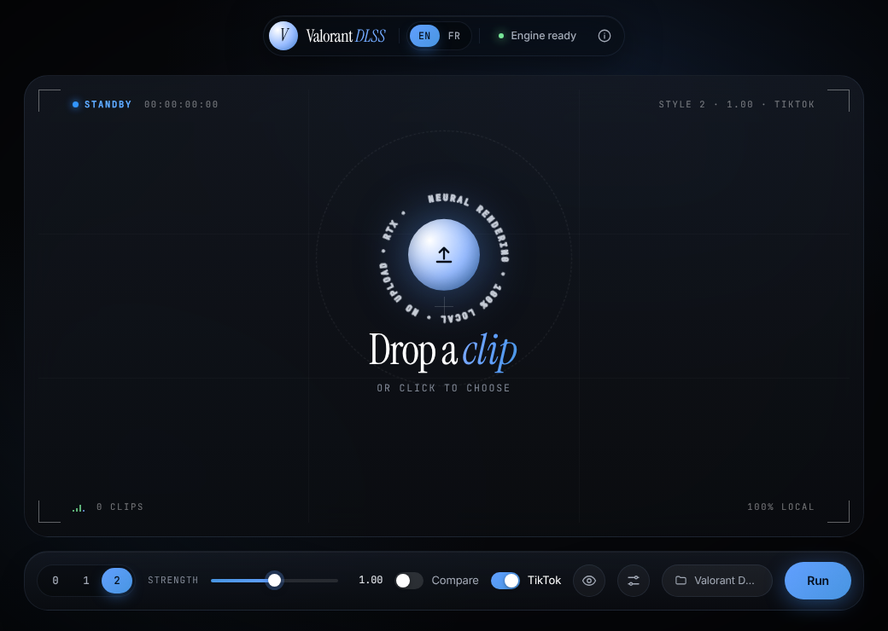
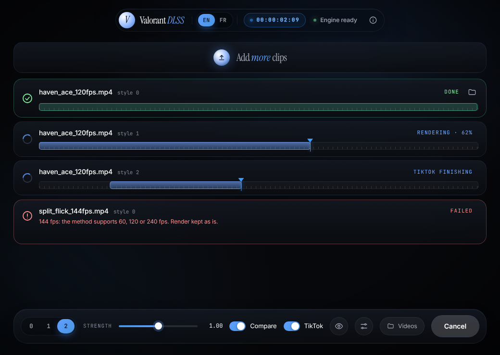
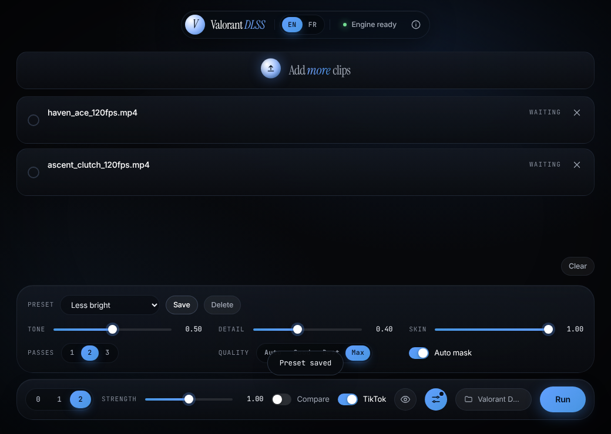

# Valorant DLSS

[English](README.md) · **Français**

[](https://github.com/nildontsleep/val-dlss/actions/workflows/build.yml)
[](LICENSE)


Une app **locale**, **Windows uniquement** et volontairement minimale pour appliquer le Neural Rendering à tes clips Valorant : tu déposes un clip, tu choisis un style, tu lances. L'anglais est la langue par défaut, le français est à un clic.

C'est une interface simple pour le moteur de Neural Rendering de [Visual Enhancer](https://github.com/Merserk/dlss5-visual-enhancer) de Merserk. Elle ne contient **ni le moteur, ni aucun fichier NVIDIA** : elle pilote le Visual Enhancer installé sur ta machine. L'installeur embarque en revanche FFmpeg, pas besoin de le chercher.



## Fonctionnalités

- **Dépose et lance** : glisse des clips, choisis un style (0, 1 ou 2) et une intensité, appuie sur Lancer.
- **Comparer** : un export par style, rangés dans des sous-dossiers.
- **Aperçu d'une frame** (👁) : original / résultat avec un curseur de comparaison et une timeline pour choisir la frame ; il se met à jour quand tu changes un réglage. **3 styles** affiche les styles 0, 1 et 2 de la même frame côte à côte ; clique sur l'un pour l'utiliser.
- **Réglages avancés et presets** (⚙) : Tonalité, Détails, Peau, Passes, Masque auto et qualité d'encodage, plus tes propres presets.
- **Plafond de taille optionnel** qui ne sacrifie jamais la qualité : un export n'est ré-encodé pour tenir dedans que si ça reste à 60 Mb/s ou plus (voir plus bas).
- **Méthode qualité TikTok** de **paschafps** : réécrit les timestamps sans ré-encoder, pour des clips en 60, 120 ou 240 fps.
- **Anglais et français** (sélecteur EN | FR, mémorisé).
- **100 % local** : tes clips ne quittent jamais ta machine, aucune télémétrie, aucun compte. Le seul appel réseau est une vérification de mise à jour optionnelle au lancement (voir [Mises à jour](#mises-à-jour)).

| En cours | Réglages avancés |
| --- | --- |
|  |  |

*Les captures sont prises avec un moteur simulé ; la scène de l'aperçu dans la capture « avancés » est une image synthétique, pas un vrai rendu. L'interface y est en anglais, la langue par défaut.*

## Prérequis

- Windows 11 (64 bits).
- Une carte NVIDIA GeForce RTX prise en charge par le Neural Rendering de Visual Enhancer (voir son README pour le détail).
- [Visual Enhancer](https://github.com/Merserk/dlss5-visual-enhancer/releases) : télécharge et extrais le ZIP.
- [FFmpeg](https://ffmpeg.org/download.html) (`ffmpeg.exe`) : nécessaire pour l'aperçu et la méthode TikTok. **Inclus dans l'installeur** ; seule la version portable demande de le fournir.

## Installation

1. Télécharge depuis la page des [Releases](../../releases) :
   - **`Valorant-DLSS-Setup-x.y.z.exe`** (recommandé) : installeur, FFmpeg inclus. Installation par utilisateur, sans droits administrateur, raccourcis créés.
   - `Valorant-DLSS-x.y.z-portable.exe` : rien à installer, plus léger ; tu fournis `ffmpeg.exe` toi-même.
2. Télécharge et extrais [Visual Enhancer](https://github.com/Merserk/dlss5-visual-enhancer/releases) à part. Il n'est **pas** embarqué, volontairement : sa licence n'autorise pas sa redistribution sans l'accord écrit de son auteur, et il s'appuie sur des composants NVIDIA qui ne doivent pas être reconditionnés.
3. Lance l'app. Elle cherche Visual Enhancer (Téléchargements, Bureau, Documents) et, en version portable, `ffmpeg.exe` (dossier de Visual Enhancer, puis ton `PATH`). Si elle ne trouve pas quelque chose, elle te le demande une fois.
4. Dépose un clip et appuie sur **Lancer**. Les exports arrivent dans `Vidéos\Valorant DLSS`.

> **Windows SmartScreen / antivirus.** L'exécutable n'est pas signé : SmartScreen peut afficher un avertissement (« Informations complémentaires » → « Exécuter quand même »), et certains antivirus signalent parfois les apps Electron non signées. Le code est public et la release est construite par [GitHub Actions](https://github.com/nildontsleep/val-dlss/actions) à partir de ce dépôt ; tu peux aussi la compiler toi-même (voir [Développement](#développement)).

Tes réglages sont dans `%APPDATA%\Valorant DLSS\settings.json` ; les fichiers temporaires de l'aperçu dans `%TEMP%\valorant-dlss` (supprimés à la fermeture).

## Comment fonctionnent les réglages

| Réglage | Effet |
| --- | --- |
| Style 0 / 1 / 2 | Les trois rendus du moteur |
| Intensité | Force de l'effet (0 à 2) |
| Comparer | Un export par style |
| TikTok | La méthode qualité TikTok (ci-dessous) |
| Tonalité · Détails · Peau | Forces *local tone*, *local structure* et *skin structure* de Visual Enhancer (0 à 1) |
| Passes | Nombre de fois que la passe neurale est appliquée (1 à 3) |
| Masque auto | Le masque automatique du moteur (désactivé par défaut dans Visual Enhancer) |
| Qualité | Qualité d'encodage du fichier exporté |
| Taille max | Plafond optionnel en Mo pour le fichier exporté (vide = désactivé), voir plus bas |

Les valeurs avancées sont transmises à Visual Enhancer par un fichier preset que l'app écrit au format du moteur, et validé avec `--dry-run` avant chaque rendu : un preset refusé est signalé au lieu d'être ignoré en silence. Si ta version de Visual Enhancer est plus ancienne et refuse la dernière `schema_version` du preset, l'app essaie des versions plus anciennes. Le preset n'est écrit que si une valeur s'écarte des valeurs par défaut de Visual Enhancer.

**Aperçu.** L'aperçu extrait une frame avec FFmpeg et la rend dans le pipeline *image* de Visual Enhancer. Une frame n'a pas de mouvement (pas de flux optique) : la vidéo finale peut légèrement différer.

### Taille max, sans perdre en qualité

Les exports doivent rester vers **60 Mb/s ou plus** : le plafond est donc une limite protégée par un plancher, pas un objectif à atteindre.

- Si le rendu est déjà sous le plafond, rien ne se passe.
- S'il le dépasse, et que tenir dedans demande **60 Mb/s ou plus**, l'app ré-encode la vidéo avec ta carte graphique (H.264 NVENC, audio copié) pour tenir dedans.
- Si tenir dedans demande **moins de 60 Mb/s**, l'app **garde le rendu tel quel** et t'indique ce qu'il aurait fallu. Elle ne dégrade jamais la qualité sous le plancher pour atteindre un chiffre.

La taille est en Mo décimaux (comme Discord et la plupart des sites) avec une petite marge de sécurité. Pour repère, 60 Mb/s font environ 7,5 Mo par seconde de vidéo : un clip de 10 s pèse déjà ~75 Mo, donc un plafond de 10 ou 25 Mo n'est atteignable que pour de très courts clips. Le ré-encodage est une seconde passe avec perte et demande une carte NVIDIA avec NVENC ; avec la méthode TikTok, le plafond passe d'abord et l'étape TikTok ne fait que copier les flux.

### Méthode qualité TikTok

Équivalent de `paschafps_TikTok_Quality_Method_v2.bat` : après le rendu, FFmpeg réécrit les timestamps du clip **sans ré-encoder** (`-itsscale`, flux copiés) pour des clips en **60, 120 ou 240 fps** (×2, ×6, ×12). Les fps sont détectés automatiquement.

- Le fichier `_tiktok.mp4` obtenu est **ralenti** (×2, ×6 ou ×12) : ce n'est pas un fichier à regarder tel quel.
- Si les fps ne sont pas 60, 120 ou 240, ou si FFmpeg échoue, le rendu Neural Rendering est conservé tel quel et l'app l'indique.
- L'effet de cette méthode sur la qualité côté TikTok n'a pas été mesuré ici ; l'app reproduit la commande du script, rien de plus. Désactive « TikTok » pour obtenir un fichier à vitesse normale.

## Mises à jour

Au lancement, l'app fait **une seule** requête vers l'API publique des Releases GitHub de ce dépôt (sans compte, sans identifiant, sans télémétrie) pour savoir si une version plus récente existe. Si oui, un bouton **Mettre à jour** apparaît dans la barre du haut. Rien ne se passe tant que tu n'as pas cliqué :

- **Version installée** : le nouvel installeur est téléchargé, son **SHA-256 est comparé à celui que GitHub publie pour le fichier**, puis seulement lancé. Le fichier est refusé au moindre écart.
- **Version portable** : le bouton ouvre la page des Releases.

Tu peux désactiver la vérification dans **À propos** (ⓘ) → *Chercher les mises à jour au lancement*. Rien ne tourne en arrière-plan et il n'y a pas d'icône dans la zone de notification.

## Politique de support

C'est un projet perso gratuit, maintenu par une seule personne. Pour que ça reste tenable :

- **Tout passe par les issues GitHub.** Bugs, questions, demandes de fonctionnalités, traductions : [ouvre une issue](../../issues/new/choose) avec le modèle correspondant. Cherche d'abord dans les issues existantes.
- **Aucun support sur Discord** (messages privés, serveurs, demandes d'ami), **sauf pour les bugs majeurs.** Même dans ce cas, ouvre une issue pour que ce soit suivi et que d'autres retrouvent la réponse.

**Ce qui est un bug majeur**

- L'app ne démarre pas, ou plante dès le lancement, sur un Windows 11 normal.
- Tous les rendus échouent alors que Visual Enhancer et FFmpeg fonctionnent très bien seuls.
- L'app écrase, corrompt ou supprime tes clips d'origine ou d'autres fichiers.
- L'app fige ton ordinateur, ou laisse des processus (`VE_CLI.exe`, `ffmpeg.exe`) tourner indéfiniment après sa fermeture.
- Un problème de sécurité. Dans ce cas, **ne le publie pas** : voir [SECURITY.md](SECURITY.md).

**Ce qui n'est *pas* un bug majeur** (utilise une issue, pas Discord)

- Défauts d'interface, traductions fausses ou manquantes, petits soucis de mise en page.
- Demandes de fonctionnalités et « ce serait bien si… ».
- Les questions « comment faire… ? », la qualité d'un rendu, ou le comportement de la méthode TikTok sur TikTok.
- Les problèmes qui viennent de Visual Enhancer lui-même (plantage de son rendu, GPU non pris en charge, résultats du modèle) : à signaler dans [son dépôt](https://github.com/Merserk/dlss5-visual-enhancer/issues).
- Les problèmes liés à Valorant, au Vanguard de Riot ou à tes pilotes.

Les issues reçoivent des étiquettes (`bug`, `major-bug`, `enhancement`, `question`, `i18n`, `ui`, `engine`…) : voir [Étiquettes](#étiquettes-des-issues). La politique complète est dans [SUPPORT.md](SUPPORT.md).

## Contribuer

Les contributions sont les bienvenues : signalements de bugs, idées, traductions, documentation, code. Lis d'abord [CONTRIBUTING.md](CONTRIBUTING.md) : il explique la mise en place, la philosophie du projet (une app minimale, aucune option que personne n'utilisera, local d'abord) et les règles (par exemple : ne jamais embarquer Visual Enhancer ni des fichiers NVIDIA, et FFmpeg uniquement via le script de téléchargement épinglé). Les issues [`good first issue`](../../labels/good%20first%20issue) et [`help wanted`](../../labels/help%20wanted) sont de bons points de départ. En contribuant, tu acceptes que ton travail soit publié sous [licence MIT](LICENSE).

Lis aussi le [Code de conduite](CODE_OF_CONDUCT.md).

## Étiquettes des issues

| Étiquette | Signification |
| --- | --- |
| `bug` | Quelque chose ne fonctionne pas comme prévu |
| `major-bug` | Plantage au lancement, tous les rendus en échec, perte de données… (voir plus haut) |
| `enhancement` | Demande de fonctionnalité ou amélioration |
| `question` | Question d'utilisation |
| `documentation` | README, guides, infobulles |
| `i18n` | Traductions et langues |
| `ui` | Interface et design |
| `engine` | Lié à Visual Enhancer (en amont) |
| `tiktok-method` · `preview` · `advanced-settings` · `presets` · `performance` | Zone de l'app |
| `needs-triage` · `needs-info` | En attente de relecture / de précisions |
| `good first issue` · `help wanted` | Bons points d'entrée pour contribuer |
| `duplicate` · `invalid` · `wontfix` | Fermées sans suite |

## Développement

```bash
npm ci
npm test        # tests unitaires et moteur (sans GPU : faux moteur et faux ffmpeg)
npm start       # lance l'app (Electron)
npm run dist    # exécutable portable dans dist/portable/ (à lancer sous Windows)
npm run dist:installer   # installeur NSIS dans dist/installer/ (télécharge et vérifie d'abord le FFmpeg épinglé)
```

La CI utilise Node.js 22. Les tests n'ont besoin ni d'un GPU ni de Windows.

La CI ([`build.yml`](.github/workflows/build.yml)) teste et construit sur `windows-latest`. Pour publier l'exécutable en Release, pousse un tag `v*` (`git tag v0.5.0 && git push origin v0.5.0`) ou lance manuellement le workflow **build** depuis l'onglet *Actions* en renseignant `release_tag` (par exemple `v0.5.0`).

## Avertissements

- Projet de fan indépendant, **non affilié, sponsorisé ni approuvé** par Riot Games, NVIDIA ou Visual Enhancer. VALORANT, DLSS et RTX appartiennent à leurs propriétaires. « Valorant DLSS » est un titre de travail.
- **Export hors ligne uniquement.** Ne lance pas de rendu neural pendant une partie en ligne : l'anticheat Vanguard de Riot n'apprécie ni les overlays ni les injections.
- Visual Enhancer expose le Neural Rendering via un modèle NVIDIA qui n'est pas une API publique stable. Son fonctionnement, et son statut légal, relèvent de ce projet : lis sa licence et les conditions de NVIDIA. Ce dépôt ne redistribue aucun de ses fichiers. L'installeur embarque une build LGPL de FFmpeg non modifiée, comme exécutable séparé (voir [THIRD_PARTY_NOTICES.md](THIRD_PARTY_NOTICES.md)).
- Fourni « tel quel », sans garantie (voir la [licence MIT](LICENSE)). Utilisation à tes risques : garde une copie de tes clips d'origine.

## Crédits

- Interface par **Morpheen**.
- Méthode qualité TikTok par **paschafps**.
- Moteur : [Visual Enhancer](https://github.com/Merserk/dlss5-visual-enhancer) de Merserk.
- Design inspiré de [morpheen.dev](https://morpheen.dev).
- Composants tiers : voir [THIRD_PARTY_NOTICES.md](THIRD_PARTY_NOTICES.md).

## Licence

[MIT](LICENSE) © 2026 Morpheen.
